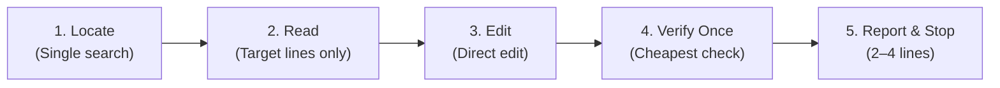

# ⚡ Lean Task (`lean-task`)

> **Stop coding agents from treating a 2-minute fix like an architectural overhaul.**  
> A lightweight, battle-tested skill and rule directive that keeps AI coding agents fast, disciplined, and strictly bounded on simple tasks.

[](LICENSE)
[](lean-task.skill)
[](#installation--setup)
[](https://github.com/Aadarshttech/lean-task/pulls)

---

## 📌 The Problem

Simple tasks fail in one predictable way: **the agent treats a 2-minute job like a senior staff architecture investigation.**

When asked to swap an image or change a string, an uncontrolled agent will:
1. Generate throwaway scratch scripts (`analyze_image.py`, `check_palette.py`, `inspect_dom.py`).
2. Run deep visual or AST analysis on things nobody asked to examine.
3. Perform unsolicited drive-by refactorings, rename neighboring variables, or reformat files.
4. Leave behind a diff across 12 files for what should have been a single line change.
5. Burn thousands of unnecessary tokens and leave the user with an exhausting code review.

**Lean Task eliminates this behavior entirely.** It enforces strict tool-call budgets, zero scratch files, and rapid single-check verification.

---

## 🎯 The Lean Task Matrix

When a prompt arrives, the agent silently sizes the task and locks into a budget:

| Size | Indicators | Tool Call Budget | File Budget | Verification Budget |
| :---: | :--- | :---: | :---: | :---: |
| **`S` (Small)** | One clear change in 1–2 files: swap asset, edit text/color/config, rename, fix typo | **Max 6 tool calls** | **0 new files created** | **1 check** (cheapest possible) |
| **`M` (Medium)** | Bug or feature touching a few files, requires localized reading | Controlled budget | 3-line plan required first | Targeted test run |
| **`L` (Large)** | Multi-module architecture change, ambiguous scope, major feature | Unbounded | Formal plan or clarify with user | Full test suite |

> **Default Rule:** If the prompt names the exact thing and the exact change, it is **`S`**. When uncertain between `S` and `M`, the agent must start as `S`.

---

## 🔄 The 5-Phase `S`-Task Loop



1. **Locate:** One search to find where the target lives (`grep -rn`, `git ls-files | grep x`). Never scan the whole codebase.
2. **Read:** Read only the lines to be edited, plus 5–10 surrounding context lines.
3. **Edit:** Apply the change directly without introducing wrapper layers or abstractions.
4. **Verify Once:** The cheapest verification that proves the change succeeded (e.g., `grep` for the new string, check asset dimensions, or single-file test).
5. **Report & Stop:** Output 2–4 lines stating what changed, where, and any key note. Then stop immediately.

---

## 🛑 Non-Negotiable Hard Rules

- 🚫 **No Scratch Scripts:** Never create `analyze_*.py`, `check_*.py`, `inspect_*.py`, `debug_*.py`, or temporary dumps in the repository. Use one-line shell commands or `python -c "..."`.
- 🚫 **Do Not Analyze Unprompted Content:** Swapping an image does not require analyzing its color palette, subject matter, or aesthetic balance. The user chose the asset; swap it.
- 🚫 **Match, Don't Investigate:** To keep layouts intact, read the old asset's dimensions/format (`file old.png`) and convert the new one only if they differ.
- 🚫 **Touch Only Target Files:** No drive-by lint fixes, cosmetic re-ordering, dependency additions, or unrelated cleanups.
- 🚫 **No New Abstractions:** Do not create helper utilities, configuration wrappers, or abstraction layers unless specifically asked. Hardcode the simple change.
- 🚫 **Do Not Re-verify:** One check is sufficient. Do not run three consecutive commands verifying the same diff.
- 🚫 **30-Second Review Principle:** If the user cannot review the resulting PR or diff in under 30 seconds, the agent failed the lean constraint.

---

## 🛠️ Recipes for Common Small Tasks

### 🖼️ Asset / Image Swapping
```bash
# 1. Locate usage
grep -rn "old-logo.png"

# 2. Check dimensions and format
file assets/old-logo.png new-logo.png

# 3. Overwrite in place (keeps all references valid)
cp new-logo.png assets/old-logo.png

# 4. Check status
git status --short
```

### 🔤 Text / Value / Config Update
```bash
# Locate, edit target line, confirm
grep -rn "MAX_RETRIES"
# [apply edit]
git diff src/config.py
```

### 🏷️ Rename Variable / Component
Use IDE-style targeted replace or `grep -rl` + single replacement, followed by a quick check for orphaned references.

---

## 📥 Installation & Setup

### Option 1: Antigravity IDE (Recommended)
1. Download the bundled [`lean-task.skill`](lean-task.skill) from this repository.
2. Drag and drop it into your Antigravity chat or copy the unzipped `lean-task/` directory to:
   ```bash
   # Windows
   %USERPROFILE%\.gemini\config\skills\lean-task

   # macOS / Linux
   ~/.gemini/config/skills/lean-task
   ```

### Option 2: Always-On Global Rule (`AGENTS.md` / `CLAUDE.md` / `.cursorrules`)
To make this behavior active on **100% of tasks** without relying on agent skill triggering, copy the contents of [`lean-task/references/always-on-rules.md`](lean-task/references/always-on-rules.md) into your project root:

```markdown
## Working style: small tasks stay small
- Size the task first. If the request names the exact change (swap an image, edit text/value, rename, fix a typo), it is SMALL: max 6 tool calls, no new files.
- Never create analyze_/check_/inspect_/extract_/debug_ scripts in the repo. Use one-line shell commands or `python -c`.
- Do not analyze things I did not ask about. Use the asset or value I gave you.
- Change only the files the task needs. No refactors, no new dependencies, no new abstractions.
- Do not ask permission for obvious steps. Ask only when two interpretations give different results.
- Verify once with the cheapest check, then stop.
- Final reply: 2-4 lines. What changed, where, any caveat.
- If the task turns out bigger than it looked, say so in one line and give a 3-line plan.
```

### Option 3: One-Off Prompt Suffix
Append this snippet to any prompt in Claude, ChatGPT, Cursor, or Copilot:

```text
Small task. Smallest possible change, no new files, no extra analysis, max 6 tool calls.
```

---

## 📊 Comparison: Unconstrained vs Lean Task

| Metric | Without Lean Task | With Lean Task ⚡ |
| :--- | :--- | :--- |
| **Tool Calls** | 18–35 calls | **2–5 calls** |
| **Scratch Files** | `test_image.py`, `diff_check.py` | **0 files** |
| **Files Modified** | 6–12 files (drive-by refactors) | **Only the target file(s)** |
| **Time to Completion** | 90–180 seconds | **< 15 seconds** |
| **Token Consumption** | ~35,000–80,000 tokens | **~2,500–6,000 tokens** |
| **User Review Effort** | Tedious diff filtering | **Instant approve (< 30s)** |

---

## 📂 Repository Structure

```tree
lean-task/
├── .gitignore
├── AGENTS.md                          # Repository-level lean agent guidelines
├── LICENSE                            # MIT License
├── README.md                          # Project documentation
├── lean-task.skill                    # Ready-to-install bundled skill package
└── lean-task/
    ├── SKILL.md                       # Core agent skill instructions and protocols
    └── references/
        └── always-on-rules.md         # Standalone agent rule-block for AGENTS.md / CLAUDE.md
```

---

## 🤝 Contributing

Contributions are welcome! If you have optimized recipes for specific frameworks (Next.js, Django, Flutter, Rust, etc.) or tighter verification commands, feel free to submit a Pull Request.

1. Fork the repository
2. Create your feature branch (`git checkout -b feature/better-recipe`)
3. Commit your changes (`git commit -m 'Add Vite asset swap recipe'`)
4. Push to the branch (`git push origin feature/better-recipe`)
5. Open a Pull Request

---

## 📄 License

Distributed under the MIT License. See [`LICENSE`](LICENSE) for details.
